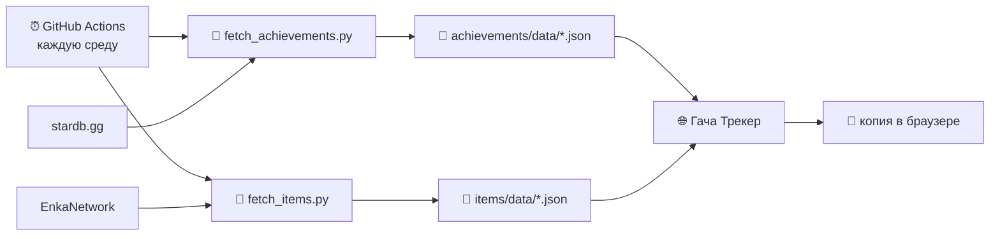

<div align="center">


# Гача Трекер

**Трекер наград, круток и достижений для Genshin Impact, Honkai: Star Rail и Zenless Zone Zero**

Работает прямо в браузере · без регистрации · ваши данные никуда не отправляются

### [Открыть трекер →](https://hexareondev.github.io/Gacha-Tracker/)


</div>

---

## Зачем это

Если вы играете в гачи от HoYoverse, то наверняка хоть раз задавались вопросами: сколько примогемов ещё можно выбить из достижений? Сколько круток в среднем уходит на пятизвёздочного? Как часто я выигрываю 50/50? Хватит ли нефрита к следующему баннеру?

Гача Трекер собирает ответы в одном месте. Это обычная веб-страница: открыли — пользуетесь. Ничего не нужно устанавливать, не нужен аккаунт, и никто, кроме вас, не видит ваших данных.

Меню разбито по играм — у каждой свой набор разделов:

| | Genshin Impact | Honkai: Star Rail | Zenless Zone Zero | Другие игры |
|:--|:--:|:--:|:--:|:--:|
| 💎 **Крутки** — запасы валюты по патчам | ✓ | ✓ | ✓ | ✓ |
| 🎯 **Шансы** — хватит ли на персонажа | ✓ | ✓ | ✓ | |
| 🎲 **История** — гаранты, 50/50 и оценка удачи | ✓ | ✓ | ✓ | |
| 🏆 **Достижения** — полный список с наградами | ✓ | ✓ | ✓ | |
| 📅 **Календарь** — ежедневные награды | | | ✓ | |

Для любой другой гачи можно создать свой профиль прямо в меню: в нём доступен калькулятор круток. Остальным разделам нужны данные, которые трекер умеет разбирать только для трёх игр HoYoverse.

---

## 🏆 Достижения

Полный список достижений — обычных и скрытых — с наградами, версиями появления и подсказками, как их получить.

| | Genshin Impact | Honkai: Star Rail | Zenless Zone Zero |
|:--|--:|--:|--:|
| Достижений | 1 854 | 1 950 | 969 |
| Категорий | 73 | 9 | 25 |
| Всего можно получить | 14 085 примогемов | 11 155 нефрита | 7 185 полихромов |

<sub>На 8 октября 2026 года. Базы обновляются автоматически раз в неделю.</sub>

- **Найти нужное:** фильтры по категории, версии игры (`4.x` целиком или конкретный патч), награде, сложности, скрытым и обычным. У каждой игры свои фильтры и сортировка.
- **Умный поиск:** понимает опечатки, разные окончания слов и текст, набранный не в той раскладке, — `ghbdtn` найдёт «привет». Совпадения подсвечиваются.
- **Медали:** золотая за +20, серебряная за +10, бронзовая за +5 — и счётчик собранных медалей каждого вида.
- **Не упустить важное:** отдельно помечены достижения, которые можно пропустить навсегда, требуют персонажа из баннера, растянуты на недели или взаимоисключают друг друга.
- **Видеть, сколько осталось:** сайт считает, сколько валюты вы уже получили и сколько ещё можно забрать — в целом и в любой выборке.
- **Без спойлеров:** описания скрытых достижений можно размыть, пока вы их не получили.
- **Перенести прогресс:** импорт и экспорт в формате **UIAF**, который понимают другие трекеры Genshin.

---

## 🎲 История круток

Загрузите файл истории в формате **UIGF v4** — его умеют делать популярные выгрузчики, например [stardb.gg](https://stardb.gg).

Свой выгрузчик тоже есть — для Windows и глобальных серверов. Он сам находит ссылку на историю в кэше игры, скачивает все баннеры Genshin Impact, Star Rail и ZZZ и сохраняет один файл UIGF; при повторном запуске докачивает только новые крутки.

- **[gacha_export.exe](https://github.com/hexareondev/Gacha-Tracker/releases/download/exporter/gacha_export.exe)** — запускается двойным щелчком, Python не нужен. Собирается автоматически в GitHub Actions из [`exporter/gacha_export.py`](exporter/gacha_export.py), контрольная сумма — на [странице релиза](https://github.com/hexareondev/Gacha-Tracker/releases/tag/exporter). Windows может показать предупреждение SmartScreen: у программы нет платной подписи — «Подробнее» → «Выполнить в любом случае».
- **[gacha_export.py](exporter/gacha_export.py)** — тот же выгрузчик скриптом, если установлен Python 3.8+.

- Перед загрузкой видно, что именно добавится, — ничего не перезапишется без вашего ведома.
- Можно загружать файлы из разных источников: они дополнят друг друга без дублей.
- Для каждого баннера: текущий гарант, сколько круток ушло на каждое ценное выпадение, среднее значение.
- Поддерживаются все каналы, включая коллаборации Star Rail и «повторный показ» агентов и амплификаторов в Zenless Zone Zero.
- Один файл может содержать несколько игр — записи сами разложатся по своим разделам.
- **Статистика 50/50:** выигрыши, проигрыши и гаранты размечаются сами — по пулу проигрыша: выпал на ивентовом баннере стандартный персонаж или оружие (или лимитированный, которого игра добавила в проигрыш, как Зеле в Star Rail с 3.2) — значит 50/50 проигран. Пул учитывает даты (например, Тигнари в стандарте только с 3.1), его можно поправить, а любую метку — переставить вручную.
- **Оценка удачи:** насколько ваше среднее число круток на S-ранг (5★) лучше или хуже ожидаемого — и удачливее какой доли игроков вы оказались. То же для 50/50.
- **Распределение по гаранту:** на какой крутке у вас выпадали S-ранги (5★) — рядом с тем, как это должно выглядеть по механике игры.
- Портреты выпавших персонажей и оружия, таблицей или сеткой.
- В Chrome и Edge страница может запомнить файл выгрузки и сама перечитывать его при каждом открытии.
- **Карточка удачи:** картинка с итогами, удачей по главным баннерам и последними S-рангами (5★) — чтобы похвастаться или пожаловаться друзьям.

---

## 🗂 Коллекция

Все персонажи и оружие игры — с отметкой, что уже получено, сколько копий (C0–C6, E0–E6, M0–M6, пробуждения и наложения) и когда.

- Копии из истории круток считаются сами: видно, когда выпадала каждая и на каком баннере.
- То, чего нет в истории — выпавшее до начала выгрузки, полученное за события, в магазине или через выбор персонажа, — добавляется вручную кнопками «+» и «−».
- Фильтры по типу, редкости и наличию, поиск и сортировка; сверху — сколько из всех персонажей и оружия уже есть.
- Список персонажей и оружия обновляется автоматически раз в неделю.

---

## 🪪 Витрина

Сборки персонажей из витрины профиля — как на [Enka.Network](https://enka.network), для всех трёх игр: уровень, созвездия / эйдолоны / кинограммы, навыки, оружие (конус, амплификатор), артефакты / реликвии / диски с основными и дополнительными характеристиками, комплекты и итоговые характеристики.

- Данные берутся через Enka.Network по UID — только у персонажей, выставленных в витрину профиля в игре.
- Каждая загрузка сохраняется, поэтому со временем здесь копятся сборки всех персонажей, которых вы показывали.
- Если браузер не пускает к Enka напрямую, ответ можно сохранить файлом и загрузить, или завести бесплатного посредника на Cloudflare Workers — код в [`tools/enka-proxy-worker.js`](tools/enka-proxy-worker.js).

---

## 🎯 Хватит ли на персонажа

В разделе «Крутки» трекер берёт ваш запас круток, а из истории — сколько круток прошло с последнего S-ранга (5★) и есть ли гарант после проигранного 50/50. По этим данным он считает:

- шанс получить персонажа (или оружие) с тем, что уже накоплено;
- шансы на каждую копию — вплоть до C6, E6 или M6;
- сколько круток нужно на 50% и 90% шанса и сколько — чтобы получить наверняка.

Можно посчитать персонажа и оружие вместе из одного запаса — например, «агент M0 и амплификатор»: трекер учтёт, что сначала крутится персонаж, а остаток уходит на оружие.

Есть два режима удачи: **как у всех игроков** (обычная механика игры) и **как на вашем аккаунте** — сценарий «если и дальше будет везти так же», где среднее число круток на S-ранг и доля выигранных 50/50 берутся из вашей истории. Будущие крутки от прошлых не зависят, поэтому второй режим — это «что если», а не прогноз.

Учитываются мягкий и жёсткий гарант, 50/50 у персонажей и 75/25 у оружия. Гарант и запас можно поправить вручную. Расчёт идёт только от того, что у вас уже есть, без прогнозов будущих наград.

---

## 💎 Крутки и 📅 Календарь

**Крутки** — простой учёт валюты по патчам: сколько было в начале патча, сколько стало к концу и во сколько круток это выливается. Если загружена история круток, рядом видно, сколько круток за патч ушло на персонажей, на оружие и на остальные баннеры. Для Genshin и Star Rail валюта уже заведена, для своих игр — настраивается под любую систему круток.

**Календарь** — для ежедневных наград в Zenless Zone Zero. Отмечайте, что выпало за день, и смотрите итоги за месяц и год, графики и самые удачные дни. День переключается по времени выбранного сервера, а не в полночь.

---

## 🔒 Где хранятся данные

**Только в вашем браузере.** У трекера нет сервера: всё, что вы отмечаете и загружаете, остаётся на вашем устройстве. Файлы истории круток читаются локально и никуда не отправляются.

Чтобы перенести данные на другое устройство или подстраховаться, откройте меню **···** и выберите **«Скачать резервную копию»**. Один файл сохранит всё: календарь, крутки, историю и прогресс достижений.

**Синхронизация между устройствами** — по желанию. В **Настройках** можно указать токен GitHub с правом `gist`: копия данных будет храниться в секретном gist вашего собственного аккаунта, и её можно загрузить на другом устройстве. Изменения отправляются сами раз в 5 минут, а если копию тем временем обновило другое устройство, трекер не перезапишет её и предложит сначала загрузить. Токен остаётся только в вашем браузере. У каждого, кто пользуется сайтом, — свой аккаунт и своя копия.

> [!WARNING]
> Если очистить данные браузера, записи пропадут. Время от времени сохраняйте резервную копию или отправляйте её в GitHub.

---

## ❓ Частые вопросы

<details>
<summary><b>Нужно ли вводить логин или пароль от игры?</b></summary>
<br>
Нет. Трекер не подключается к аккаунту и не просит никаких данных для входа. Историю круток вы загружаете сами — файлом, сделанным выгрузчиком (сторонним или нашим скриптом).
</details>

<details>
<summary><b>Откуда берётся список достижений?</b></summary>
<br>
Из открытой базы <a href="https://stardb.gg">stardb.gg</a>. Раз в неделю её автоматически скачивает скрипт в GitHub Actions, поэтому достижения из новых патчей появляются без участия человека.
</details>

<details>
<summary><b>Почему подсказки к достижениям на английском?</b></summary>
<br>
Так их публикует stardb.gg: названия и описания там переведены, а подсказки сообщества — нет.
</details>

<details>
<summary><b>Работает ли на телефоне?</b></summary>
<br>
Да, страница адаптирована под мобильные экраны. Игры и их разделы открываются через меню ≡ в левом верхнем углу.
</details>

<details>
<summary><b>Можно ли установить как приложение?</b></summary>
<br>
Да. В Chrome и Edge — пункт <b>«Установить как приложение»</b> в меню <b>···</b> трекера (или значок установки в адресной строке). На iPhone — <b>Поделиться → На экран «Домой»</b> в Safari. Установленный трекер открывается отдельным окном и работает без интернета.
</details>

<details>
<summary><b>Это официальный проект HoYoverse?</b></summary>
<br>
Нет, это неофициальный фанатский проект.
</details>

---

## 🛠 Свой экземпляр

Хотите собственную копию — например, чтобы что-то в ней поменять?

1. Нажмите **Fork** вверху страницы репозитория.
2. В своей копии: **Settings → Pages**, источник — ветка `main`, папка `/ (root)`.
3. **Actions** → включите workflows и один раз запустите **«Обновление баз (достижения, персонажи)»** кнопкой **Run workflow**.

Через минуту сайт будет доступен по адресу `https://<ваш-ник>.github.io/<имя-репозитория>/`, а базы достижений и персонажей начнут обновляться каждую среду.

<details>
<summary><b>Как устроен проект</b></summary>
<br>

Трекер написан на чистом HTML, CSS и JavaScript, без фреймворков и сборки: файлы отдаются как есть, каждый раздел — отдельный скрипт. Данные хранятся в `localStorage` и `IndexedDB`, офлайн-работу обеспечивает service worker.

Базы достижений, персонажей и оружия собирают Python-скрипты (только стандартная библиотека, Python 3.8+). Сайт читает их напрямую из репозитория, поэтому новые данные видны сразу после коммита.



```
├── index.html                          # разметка страницы
├── css/style.css                       # оформление
├── js/
│   ├── core.js                         # хранилище и общие утилиты
│   ├── calendar.js                     # календарь ежедневных наград
│   ├── history.js                      # история круток, портреты, удача
│   ├── pools.js                        # стандартные пулы и база персонажей
│   ├── collection.js                   # коллекция персонажей и оружия
│   ├── showcase.js                     # витрина: сборки персонажей через Enka
│   ├── backup.js                       # резервные копии
│   ├── settings.js                     # настройки и меню
│   ├── pulls.js                        # крутки и патчи
│   ├── achievements.js                 # достижения и поиск
│   ├── odds.js                         # модель гаранта и шансы
│   ├── share.js                        # карточка удачи
│   ├── sync.js                         # синхронизация и установка
│   └── nav.js                          # меню игр и запуск
├── sw.js                               # работа без интернета
├── manifest.webmanifest                # описание приложения
├── icons/                              # значки приложения
├── favicon.svg
├── achievements/
│   ├── fetch_achievements.py           # сборщик баз достижений
│   └── data/                           # базы по играм
├── items/
│   ├── fetch_items.py                  # сборщик базы персонажей и оружия
│   └── data/                           # базы и справочники характеристик по играм
├── tools/
│   └── enka-proxy-worker.js            # посредник для Enka на Cloudflare Workers
├── exporter/
│   └── gacha_export.py                 # выгрузчик истории круток
└── .github/workflows/
    ├── update-achievements.yml         # еженедельное обновление баз
    └── build-exporter.yml              # сборка gacha_export.exe
```

Запустить сборщик вручную:

```bash
python achievements/fetch_achievements.py --out achievements/data --lang ru
```

Параметры: `--games gi,hsr,zzz` — какие игры, `--lang` — язык (`ru`, `en`, `ja`…), `--source auto|stardb|fallback` — откуда брать данные.

Скрипты подключаются по порядку и делят общую область видимости, поэтому порядок `<script>` в `index.html` важен.

Если открыть `index.html` прямо с диска, всё, кроме достижений и офлайн-режима, работает сразу. Для достижений запустите локальный сервер (`python -m http.server`) или загрузите файл базы кнопкой **«Загрузить файл»**.

</details>

---

<div align="center">
<sub>Достижения — <a href="https://stardb.gg">stardb.gg</a> · Персонажи и оружие — EnkaNetwork · Портреты — Enka.Network, Project Amber, Yatta, Hakush, Nanoka<br>
Неофициальный фанатский проект. Genshin Impact, Honkai: Star Rail и Zenless Zone Zero — товарные знаки HoYoverse.</sub>
</div>
